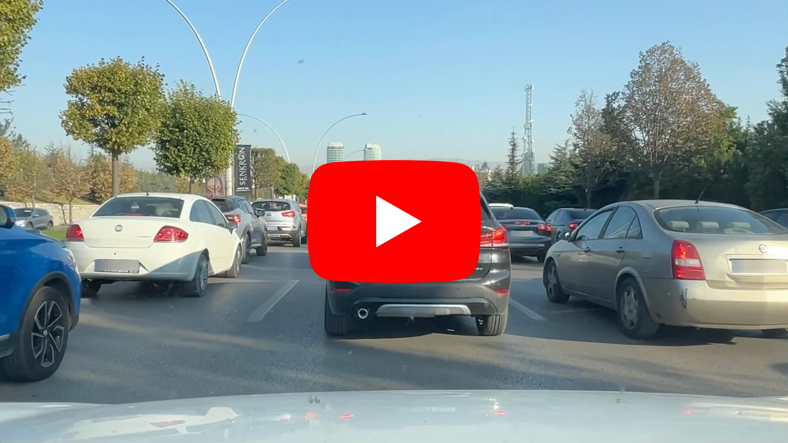
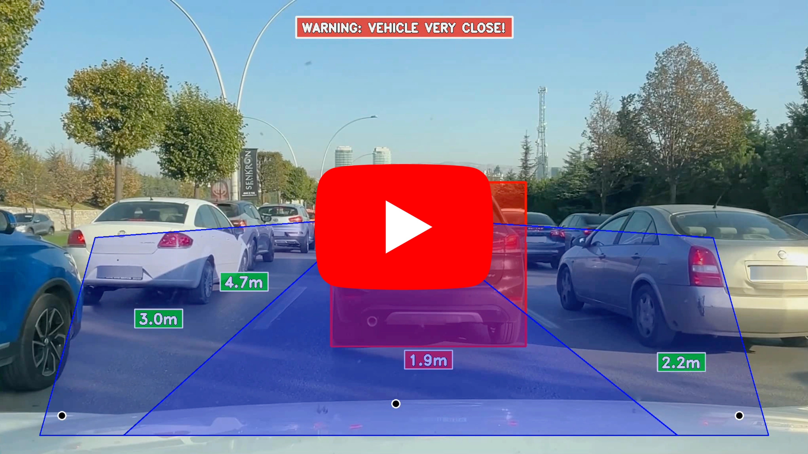
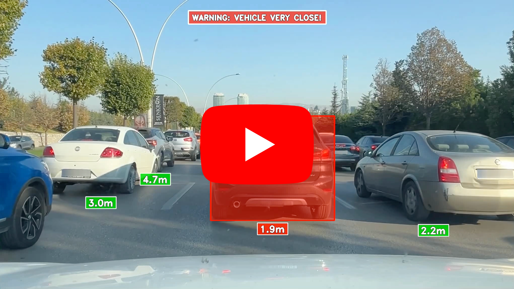

# Vehicle Distance Measurement System

## 1. Introduction

This project implements a real-time vehicle distance measurement system designed for in-vehicle dashcam applications. Using YOLOv12 object detection and monocular depth estimation through perspective geometry, the system calculates distances to surrounding vehicles with region-specific warning systems. The system monitors three ROI lanes (LEFT, MAIN, RIGHT) and automatically blurs vehicle plates for GDPR compliance. It works as a safety assistance aid for autonomous vehicles and driver monitoring.

**Core Features:**
- Real-time multi-vehicle detection using YOLOv12
- Accurate distance calculation through perspective projection
- Three-zone ROI monitoring (LEFT, MAIN, RIGHT lanes)
- Adaptable warning thresholds per lane
- Automatic vehicle plate detection and blurring
- Color-coded distance visualization
- Live safety indicators
- Annotated video recording

## 2. Methodology / Approach

The system employs a multi-component architecture combining object detection, perspective geometry, and region-based analysis:

**Object Detection:** YOLOv12 detects vehicles (cars, motorcycles, buses, trucks) and vehicle plates in real-time with high confidence.

**Distance Estimation:** Uses monocular depth estimation via perspective projection, calculating distance from bounding box height using calibrated focal length and known vehicle dimensions.

**ROI Zone Analysis:** Frame divided into three trapezoidal regions (LEFT, MAIN, RIGHT) with separate warning thresholds and display limits for context-aware alerting.

**Privacy Protection:** Automatic vehicle plate detection and Gaussian blurring for regulatory compliance.

**Adaptive Visualization:** Color-coded distance labels (red for warnings, green for safe) with zone-specific thresholds.

### 2.1 System Architecture

```
[Dashcam Video Input]
    ↓
[YOLOv12 Vehicle Detection]
    ↓
[ROI Zone Classification]
    ↓
[Distance Calculation] → [Perspective Correction]
    ↓
[Vehicle Plate Detection] → [Blurring]
    ↓
[Warning Assessment] → [Color Coding]
    ↓
[Visualization & Output]
    ↓
[Annotated Video Output]
```

### 2.2 Processing Pipeline

1. Capture frame from dashcam video
2. Run YOLOv12 detection on full frame
3. Filter detections to vehicle classes (2, 3, 5, 7)
4. Classify vehicle center into ROI zone (LEFT/MAIN/RIGHT)
5. Calculate distance using perspective projection formula
6. Apply perspective distortion correction based on offset
7. Detect vehicle plates within vehicle regions
8. Apply Gaussian blur to vehicle plates
9. Evaluate distance against zone-specific warning threshold
10. Color-code distance label (RED/GREEN) accordingly
11. Overlay distance text and warning indicators
12. Record annotated frame to output video

## 3. Mathematical Framework

### 3.1 Perspective Projection Distance Calculation

The fundamental equation relating observed bounding box height to actual distance:

$$d = \frac{h_{\text{real}} \cdot f}{h_{\text{image}}}$$

where:
- $d$ = distance from camera to vehicle (meters)
- $h_{\text{real}}$ = actual vehicle height (meters)
- $f$ = camera focal length (pixels)
- $h_{\text{image}}$ = bounding box height in pixels

### 3.2 ROI Zone Definition

Three trapezoidal regions for multi-lane monitoring (2042×1148 resolution):

$$\mathbf{ROI}_{\text{LEFT}} = \{(x, y) : (x, y) \in \text{Polygon}([[240, 600], [925, 550], [312, 1100], [100, 1100]])\}$$

$$\mathbf{ROI}_{\text{MAIN}} = \{(x, y) : (x, y) \in \text{Polygon}([[925, 550], [1025, 550], [1712, 1100], [312, 1100]])\}$$

$$\mathbf{ROI}_{\text{RIGHT}} = \{(x, y) : (x, y) \in \text{Polygon}([[1025, 550], [1802, 600], [1942, 1100], [1712, 1100]])\}$$

### 3.3 Vehicle Height Classification

Reference heights for distance calculation by vehicle type:

$$H_{\text{vehicle}} = \begin{cases}
1.55 \text{ m} & \text{if class ID} = 2 \text{ (Car)} \\
1.2 \text{ m} & \text{if class ID} = 3 \text{ (Motorcycle)} \\
3.0 \text{ m} & \text{if class ID} = 5 \text{ (Bus)} \\
2.5 \text{ m} & \text{if class ID} = 7 \text{ (Truck)}
\end{cases}$$

### 3.4 Perspective Distortion Correction

Correction factor for off-center vehicles due to perspective distortion:

$$d_{\text{corrected}} = d \cdot (1 + \alpha \cdot \delta)$$

where:
- $\alpha = 0.0001$ (displacement coefficient)
- $\delta$ = Euclidean distance from optical center to vehicle center

$$\delta = \sqrt{(x_{\text{vehicle}} - x_{\text{center}})^2 + (y_{\text{vehicle}} - y_{\text{center}})^2}$$

## 4. Requirements

```txt
opencv-python>=4.5.0
numpy>=1.21.0
ultralytics>=8.0.0
```

## 5. Installation & Configuration

### 5.1 Environment Setup

```bash
# Clone the repository
git clone https://github.com/kemalkilicaslan/Vehicle-Distance-Measurement-System.git
cd Vehicle-Distance-Measurement-System

# Install required packages
pip install -r requirements.txt
```

### 5.2 Project Structure

```
Vehicle-Distance-Measurement-System/
├─ Vehicle-Distance-Measurement-System.py
├─ config.py
├─ Dockerfile
├─ .dockerignore
├─ docker-compose.yml
├─ .gitignore
├─ README.md
├─ requirements.txt
└─ LICENSE
```

### 5.3 Required Files

- **YOLOv12 Model:** `yolo12x.pt` (automatically downloaded on first run)
- **Vehicle Plate Model:** `vehicle-plate.pt` (required for privacy protection)
- **Input Video:** Dashcam video file in supported format (MP4, MOV, AVI)

## 6. Usage / How to Run

### 6.1 Basic Execution

```bash
python Vehicle-Distance-Measurement-System.py
```

### 6.2 Configuration

All adjustable parameters live in `config.py`. Update them there without touching the main script:

```python
# Model and video files
MODEL_PATH = "yolo12x.pt"
VEHICLE_PLATE_MODEL_PATH = "vehicle-plate.pt"
INPUT_VIDEO = "dashcam_video.mov"
OUTPUT_VIDEO = "Vehicle-Distance-Measurement.mp4"

# ROI Zones (modify for different camera angles)
ROI_ZONES = {
    "LEFT":  [[240, 600], [925, 550], [312, 1100], [100, 1100]],
    "MAIN":  [[925, 550], [1025, 550], [1712, 1100], [312, 1100]],
    "RIGHT": [[1025, 550], [1802, 600], [1942, 1100], [1712, 1100]],
}

# Optical centers per zone (camera calibration)
OPTICAL_CENTERS = {"LEFT": (156, 1050), "MAIN": (1000, 1020), "RIGHT": (1868, 1050)}

# Warning distances per zone (meters)
WARNING_DISTANCES = {"LEFT": 1, "MAIN": 2, "RIGHT": 1}

# Camera and detection parameters
FOCAL_LENGTH = 500              # pixels
CONFIDENCE_THRESHOLD = 0.7
VEHICLE_PLATE_CONFIDENCE = 0.475
```

### 6.3 Controls

- Press `q` to quit the application

### 6.4 Output

The processed video is saved as:
```
Vehicle-Distance-Measurement.mp4
```

## 7. Docker Deployment

The system can be packaged and run in a container so that the code, its
dependencies and the runtime environment stay consistent across machines.

### Files

- `Dockerfile` - builds the image (Python 3.11 + OpenCV/ffmpeg system libraries + Python dependencies).
- `.dockerignore` - keeps large media and model files out of the build context.
- `docker-compose.yml` - runs the container and mounts the project folder for input/output.

### Build and run

```bash
docker compose up --build

# or with the Docker CLI directly
docker build -t vehicle-distance-measurement:latest .
docker run --rm -v "$(pwd)":/app vehicle-distance-measurement:latest
```

### Notes

- Input and output videos are read from and written to the project folder through
  the bind mount, so the annotated output video appears on the host after the run.
- The bundled plate model (`vehicle-plate.pt`) is used through the bind mount;
  standard YOLO weights are downloaded automatically on first run.
- The script calls `cv2.imshow`, which needs a graphical display. On a headless
  server the output video is still written to disk; the live preview window is
  only available on Linux with X11 forwarding (see the commented lines in
  `docker-compose.yml`).

## 8. Application / Results

### 8.1 Input Video

[](https://www.youtube.com/watch?v=x1u2iy4csSI)

### 8.2 Vehicle Distance Measurement in Region of Interest

[](https://www.youtube.com/watch?v=XFv5MAkfYpA)

### 8.3 Output Video

[](https://www.youtube.com/watch?v=1QwOh9GxzV8)

## 9. System Configuration

### 9.1 Vehicle Classes

| Class ID | Vehicle Type | Reference Height |
|----------|--------------|------------------|
| 2 | Car | 1.55 m |
| 3 | Motorcycle | 1.2 m |
| 5 | Bus | 3.0 m |
| 7 | Truck | 2.5 m |

### 9.2 Warning System Thresholds

| Lane | Warning Distance | Display Limit |
|------|------------------|---------------|
| LEFT | 1.0 m | 5.0 m |
| MAIN | 2.0 m | 15.0 m |
| RIGHT | 1.0 m | 5.0 m |

### 9.3 Color Coding

- **RED:** Vehicle distance below warning threshold OR main lane vehicles < 5m
- **GREEN:** Safe distances above threshold
- **No Label:** Distances beyond display limit for lane

### 9.4 System Parameters

| Parameter | Value | Unit | Description |
|-----------|-------|------|-------------|
| Focal Length | 500 | pixels | Camera focal length calibration |
| Vehicle Confidence | 0.7 | - | Detection threshold for vehicles |
| Vehicle Plate Confidence | 0.475 | - | Detection threshold for plates |
| Max Display Distance | 15 | meters | Maximum distance shown in MAIN lane |
| Displacement Coefficient | 0.0001 | - | Perspective correction factor |

## 10. Tech Stack

### 10.1 Core Technologies

- **Language:** Python 3.7+
- **Computer Vision:** OpenCV 4.5+
- **Deep Learning:** Ultralytics YOLO 8.0+
- **Object Detection & Tracking:** YOLOv12
- **Numerical Computing:** NumPy 1.21+

### 10.2 Dependencies

| Library | Version | Purpose |
|---------|---------|---------|
| opencv-python | 4.5+ | Video I/O, image processing, visualization |
| ultralytics | 8.0+ | YOLOv12 vehicle and vehicle plate detection |
| numpy | 1.21+ | Array operations and geometric calculations |

### 10.3 Pre-trained Models

- **YOLOv12 (Extra Large):** `yolo12x.pt`
  - Architecture: YOLOv12 deep learning model
  - Classes: 80 COCO classes including vehicles
  - Purpose: Vehicle detection and classification

- **Vehicle Plate Detection Model:** `vehicle-plate.pt`
  - Specialized model for vehicle plate regions
  - Trained on vehicle plates
  - Purpose: Privacy protection through automated blurring

## 11. License

This project is licensed under the [Creative Commons Attribution-NonCommercial-NoDerivatives 4.0 International (CC BY-NC-ND 4.0)](https://github.com/kemalkilicaslan/Vehicle-Distance-Measurement-System/blob/main/LICENSE). 

## 12. References

1. Ultralytics [YOLOv12](https://docs.ultralytics.com/models/yolo12/) Documentation.
2. OpenCV [Camera Calibration and 3D Reconstruction](https://docs.opencv.org/4.x/d9/d0c/group__calib3d.html) Documentation.

---

### Acknowledgments

Thanks to the Ultralytics team for the YOLO framework and YOLOv12 models, and to the OpenCV community for their camera calibration and computer vision tools. The perspective projection method is based on standard pinhole camera models. Sample dashcam footage used for demonstration purposes only.

---

**Note:** This system is calibrated for specific dashcam configurations. Recalibrate focal length and ROI zones when using different camera equipment. Ensure compliance with local laws regarding vehicle data collection and dashcam recording. This project is intended for research, educational, and authorized commercial applications in vehicle safety systems. Always prioritize driver safety and avoid distraction when using in-vehicle monitoring systems.